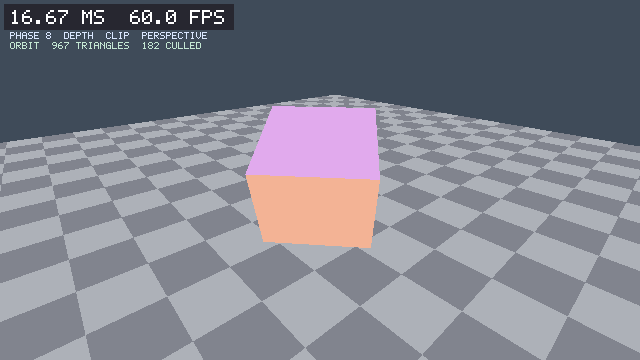
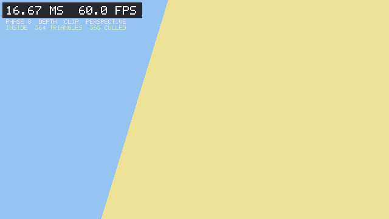

# Phase 8 report: depth, clipping, and perspective

Date: 2026-10-24
Commits: `3500c23` (pipeline, cameras, tests, consumers) and `e94b60e`
(depth sample)
Machine: Windows 10 Pro 19045, Intel Core i5-6400 (4 cores, 4 threads), 16 GB
RAM, Intel HD 530, MSVC 19.44.35229 (Visual Studio 2022 Build Tools), CMake
3.31.6, Ninja preset builds, clang-format 23.1.3 for the local format gate

## What was built

`cyber_software_renderer` now has a complete Phase 8 vertex pipeline: object,
world, view, and clip spaces; a homogeneous near-plane clipper; back-face
culling; a float reverse-Z depth buffer with a greater-or-equal test; and
perspective-correct color. Triangles keep the Phase 7 snapping, top-left rule,
tile binning, and deterministic output.

### Public API

`include/cyber/software/` gains three headers:

| Header | Contents |
|---|---|
| `depth_buffer.h` | `DepthBufferDesc`, `DepthBuffer` (move-only, allocator-backed, clear to a value, `TestAndWrite`, row access). |
| `camera.h` | `Camera`, `CameraForward/Right/Up`, `CameraView`, `CameraProjection`, `FlyCamera`/`FlyCameraInput`/`UpdateFlyCamera`, `OrbitCamera`/`OrbitCameraInput`/`UpdateOrbitCamera`/`OrbitCameraPosition`/`OrbitCameraView`/`OrbitCameraProjection`. |
| `pipeline.h` | `Vertex`, `Viewport`, `CullMode`, `FrontFace`, `PipelineDesc`, `PipelineStats`, `ClipVertex`, `ClipPolygon`, `ClipTriangleNearPlane`, `DrawTriangles`. |

`raster.h` gains `DepthRasterVertex`, `DepthRasterTriangle`,
`RasterizeDepthTestedTriangles`, and `RasterStats::pixelsRejected`. Every Phase
7 type and function is unchanged.

### Vertex path and clipping

1. `clip = projection * view * model * position`.
2. The triangle is clipped against `z = w` (the near plane in reverse-Z) with
   one Sutherland-Hodgman pass in homogeneous space. The result is the original
   three vertices or a quad; a quad is fan-triangulated. Every intersection
   satisfies `z == w`, and vertices exactly on the plane are not duplicated.
3. Each surviving vertex is divided by `w`, mapped into the viewport with a y
   flip, and checked against the +/-16384-pixel guard band that the 24.8
   fixed-point rasterizer already enforces.
4. Signed screen-space area selects the winding. `FrontFace::CounterClockwise`
   (the default) is the front face of right-handed object geometry, matching
   D3D12's `FrontCounterClockwise = TRUE`; the viewport y flip preserves the
   projected winding. `CullMode` can keep both, back, or front faces.
5. Triangles are binned and rasterized exactly as in Phase 7, now with a depth
   test and perspective-correct color.

The clipper is public so its output is tested directly: all-inside triangles are
unchanged, one outside vertex yields a quad with two `z == w` intersections and
lerped color, two outside vertices yield a triangle, all-outside yields nothing,
and an on-plane vertex is kept once.

### Depth and perspective

- `DepthBuffer` stores binary32 samples. `Clear()` writes 0; `TestAndWrite`
  passes when `depth >= stored`, so nearer geometry always wins and NaN never
  passes.
- `z_ndc` is affine in screen space, so depth is interpolated with the unbiased
  barycentric weights. Color uses
  `(sum b_i * c_i * invW_i) / (sum b_i * invW_i)` with `invW = 1 / w` computed
  per vertex, one division per covered pixel.
- A covered sample that fails depth leaves both targets untouched and counts in
  `pixelsRejected`.

### Cameras

`Camera` is a right-handed value with position, yaw around +Y, pitch, field of
view, and near/far planes. `CameraView` and `CameraProjection` delegate to the
existing `Mat4::LookAt` and `Mat4::PerspectiveReverseZ`. `FlyCamera` moves along
its local axes, normalizes diagonal movement, clamps pitch short of the poles,
and clamps its time step to 0.25 s so a debugger stall cannot teleport it.
`OrbitCamera` places the eye on a sphere around a target, clamps pitch and
distance, branches zoom exponentially so distance never reaches zero, and pans
in world space. Both controllers take plain deltas; the sample maps
`cyber_platform::InputState` to them, so the renderer stays free of key codes.

### Clear-path optimization

The full-frame clears became measurable once a second float target existed.
`Framebuffer::ClearRect` now fills a complete row by doubling a prebuilt pixel
pattern instead of storing one pixel at a time, and `DepthBuffer::Clear(0)`
uses `memset` because the reverse-Z far value is all-zero bytes. Clear dropped
from 5.34 ms to 1.78 ms at 1280x720. Both changes are byte-identical: the Phase
7 capture hash below is unchanged.

### Sample

`samples/03_depth` builds a 36-vertex cube with one color per face and a 24 x 24
checkerboard floor (1,152 triangles), depth-tests them through `DrawTriangles`,
packs to sRGB, and presents at 60 Hz. Orbit is the default camera; Tab switches
to fly (initialized from the orbit pose), the left mouse button rotates, the
wheel zooms, WASD/QE move, and Shift is fast. `--capture` writes two
byte-identical files; `--inside` places the camera at the cube centre with
culling disabled so the near clipper must cut every face. `--frames` bounds the
window run and prints scene, clear, draw, pack, present, pacing, and event
costs.

## Decisions

ADR [0010](../adr/0010-depth-clipping-and-perspective.md) and the
[Phase 8 design note](../design/phase-08-pipeline.md) record:

- Clip space is `-w..w` in x and y and `0..w` in z with the D3D convention.
  Only the near plane is clipped; the far plane loses to the cleared-to-zero
  reverse-Z test, and the side planes use a +/-16384-pixel guard band.
- Depth is greater-or-equal against a buffer cleared to 0; values below 0 are
  rejected.
- Attributes are perspective-correct with one per-pixel division; the Phase 7
  affine path keeps its original arithmetic.
- Positive screen-space area is clockwise; `FrontFace::CounterClockwise` is the
  default for right-handed geometry.
- Culling happens after clipping and before binning. Tile size and worker count
  remain scheduling parameters that never change the image.
- Cameras expose values and delta-based controllers without platform types.

## Evidence for done-when

The roadmap done-when line is: *a rotating depth-tested cube renders with no
artifacts, including when the camera moves through the near plane.* The build
guide adds: *unit tests cover the clipper's output.*

### Test suites

| Suite | Tests | Release time |
|---|---:|---:|
| `software_depth_buffer` | 5 | 0.02 s |
| `software_camera` | 5 | 0.02 s |
| `software_pipeline` | 10 | 0.05 s |

Total CTest entries: 44 (41 from Phases 1-7 plus the three new suites).

| Preset | Result |
|---|---|
| `debug` | 44/44 passed |
| `release` | 44/44 passed |
| `shipping` | 44/44 passed |
| `debug-asan` | 44/44 passed |

`software_pipeline` covers: a full-screen quad at depth 0.5 fills 8x8 and writes
depth 0.5 everywhere; the viewport offset writes only its 4x4 rectangle; positive
NDC y lands in the top rows; back-face culling rejects a reversed quad and
`CullMode::None`/`Front` behave as configured; a nearer quad wins in either
submission order and equal depth resolves by submission order; a triangle
crossing the near plane submits 1-2 clipped triangles with finite pixels; a
triangle wholly behind the camera is culled instead of wrapping; an off-axis
vertex is reported as offscreen; perspective color matches
`3/5.5, 0.5/5.5, 2/5.5` at the 3/7-2/7-2/7 barycentric sample and differs from
the affine result; the cube renders 6 front and 6 back faces from a fixed pose
with identical color and depth bytes across tile sizes 16/64/128; a camera
inside the cube with culling disabled is clipped but writes only in-range depth;
and invalid targets, viewports, vertex counts, and attribute values are
rejected. `software_depth_buffer` covers reverse-Z ordering, equal-depth
rewrites, negative depth, NaN, stride padding, moves, and invalid descriptors.
`software_camera` covers the basis, view mapping, reverse-Z near/far mapping,
aspect scaling, frame-rate-independent flight, diagonal normalization, pitch
and distance clamps, exponential zoom, and pan.

AddressSanitizer also caught a test-side dangling reference:
`CG_EXPECT_EQ(pixel.GetPixel(...).r, ...)` binds a reference to a member of a
temporary. The test now stores the `Color` first; the library was unaffected.

### Phase 7 regression

The Phase 7 capture hash is unchanged after the rasterizer refactor:

```text
capture: phase7_final.ppm (691215 bytes) and phase7_final.copy.ppm (691215 bytes) are byte-identical
SHA256 B8A16B9AC5AFF7E709D34D4430C66838FE72B5EE75C09756677E8E4BD39B8B82
```

That is the same SHA256 recorded in the Phase 7 report, so the affine path and
its tile binning produce bit-identical output.

### Captures

```text
capture: 967 triangles submitted, 182 culled, 58 clipped, 154788 pixels
capture: phase8_depth.ppm (691215 bytes) and phase8_depth.copy.ppm (691215 bytes) are byte-identical
SHA256 9476FAC51D33EACC7F71CBAA02881CCE08439D44BF2F95D7A3769F59531BA520

capture: 564 triangles submitted, 565 culled, 56 clipped, 230400 pixels
capture: phase8_inside.ppm (691215 bytes) and phase8_inside.copy.ppm (691215 bytes) are byte-identical
SHA256 4F57739F67FE62635593E8B576F0375FB1152E51D711A9A39200D909386BAC4B
```



The standard capture shows the three visible cube faces (the hidden faces are
culled), correct occlusion against the floor, and checker squares that converge
toward the horizon, which is the visible proof that interpolation is
perspective-correct rather than affine.



The inside capture places the camera at the cube centre: 56 input triangles
crossed the near plane, 565 were clipped away or culled, and every one of the
230,400 pixels has a finite color and an in-range depth. No vertex from behind
the camera wraps onto the screen.

### Performance

`release`, 1280x720, 300 presented frames:

```text
depth sample closed after 300 frames, smoothed 16.67 ms (60.0 FPS)
last frame: 920 submitted, 180 culled, 58 clipped, 617167 pixels, 71453 rejected
average frame: scene 0.03 ms, clear 1.78 ms, draw 3.44 ms, pack 8.10 ms,
               present 2.17 ms, pacing 1.19 ms, events 0.01 ms
```

The sample holds the 60 Hz target. The depth-tested raster costs 3.44 ms for
617k written and 71k rejected samples, including the per-pixel perspective
divide. Present packing remains the largest single segment at 8.10 ms; that is
the Phase 6 sRGB conversion, not the pipeline. The `debug` build is
unoptimized and is not a performance target.

### Repository checks

```text
python scripts/check_structure.py   -> Structure check passed: 16 modules, 1 contract(s).
python scripts/layer_check.py       -> Layer check passed: 16 modules.
python scripts/check_format.py      -> Formatting check passed: 179 files.
scripts/verify_package.ps1 -Preset debug    -> install, package consumer, source consumer: exit 0
scripts/verify_package.ps1 -Preset release  -> install, package consumer, source consumer: exit 0
```

The package consumer now includes `depth_buffer.h`, `camera.h`, and
`pipeline.h`, draws a 2x2 depth-tested quad through the installed package, and
requires four pixel writes and a depth of 0.5. The install check requires the
three new headers in the exported package.

### CI

CI has not run for these commits yet: the branch has not been pushed, and this
session is not authorized to push. The local gates above are the evidence that
the Windows MSVC and Linux clang jobs will exercise; the CI link is added when
the owner pushes `3500c23..e94b60e`.

## Known gaps

- Side-plane geometry outside +/-16384 pixels is dropped, not clipped. A camera
  pressed against a large polygon can lose a triangle at extreme angles;
  six-plane clipping is the fix. Recorded in ADR 0010.
- No index buffers; `DrawTriangles` takes a triangle list and clamps no vertex
  count beyond the multiple-of-three rule. Phase 9 adds indices with the OBJ
  loader.
- No textures, lighting, or arbitrary varyings. Phase 9 adds textures and C++
  shaders; Phase 26 adds physically based shading. The flat colors here are the
  pipeline reference, not the renderer's final look.
- No anti-aliasing or mipmaps, so distant checker squares alias. Phase 9 adds
  mipmaps; Phase 30 adds anti-aliasing.
- One perspective division per covered pixel and no reciprocal approximation;
  the reference renderer favours determinism.
- Coplanar geometry still z-fights; greater-or-equal is deterministic but has no
  depth bias.
- The sample is Windows-only for its window path because the Linux window
  backend is null; the headless capture compiles and runs on Linux CI.
- The stable C ABI remains empty until Phase 25.

## Sources used

- Microsoft, "Rasterization Rules" (Direct3D 11) and the Direct3D clip-space and
  viewport documentation.
- Fabian Giesen, "A trip through the Graphics Pipeline 2011", parts 2, 3, 5, and
  6 (clip space, perspective correction, guard bands).
- Steven T. Barrett, "Depth Precision Visualized" (reverse-Z).
- Sutherland and Hodgman, "Reentrant Polygon Clipping", CACM 1974.
- Scratchapixel, "The Visibility Problem" and the projection/clipping chapters.
- Tomas Akenine-Möller et al., *Real-Time Rendering* (background reading).
- C++20 standard library: `std::clamp`, `std::fill_n`, `std::memset`,
  `std::isfinite`, `std::exp`, `std::atan2`.
- CyberGraphics ADR 0002, ADR 0009, ADR 0010, the Phase 8 design note, and the
  module contract.

## What the next phase needs from this one

Phase 9 can rely on:

- `DrawTriangles` as the geometry entry point, with `Vertex` ready to grow
  shader varyings and an index path.
- `DepthBuffer` and the reverse-Z greater-or-equal convention for any later
  pass, including the GPU reference comparisons in Phase 14.
- `pixelsRejected` and the other `PipelineStats` counters as the visible-cost
  diagnostic for texture and lighting work.
- The 44-test suite, including the clipper and perspective tests, as the
  regression gate for shaders and textures.
- The Phase 7 capture hash as proof that the affine path must stay
  byte-identical.
- The clear fast path for any additional render target.
