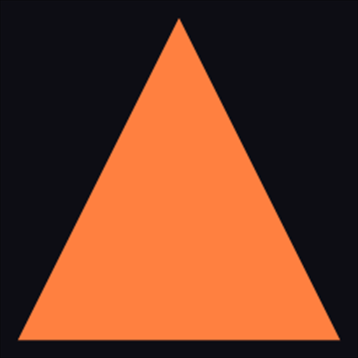
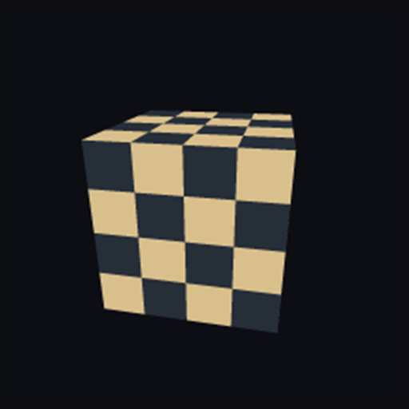

# Phase 14 report: Direct3D 12 backend

Date: 2026-10-27
Commits: `ed4a97a` (increment 1) through `691e8d9` (increment 6); increment 7 is
the commit that adds this report — see
`git log --oneline -- engines/cyber_rhi/src/d3d12 tests/integration/backend_compare`
Machine: Windows 10 Pro 10.0.19045, Intel Core i5-6400 (4 cores), Intel HD
Graphics 530 (driver 31.0.101.2125), MSVC 19.44 (Visual Studio 2022 Build Tools,
toolset 14.44.35207), CMake 3.31.6, Ninja
Design note: [phase-14-d3d12.md](../design/phase-14-d3d12.md)
ADR: [0017](../adr/0017-d3d12-backend.md)
Contract: [`cyber_rhi`](../../engines/cyber_rhi/docs/MODULE.md)

The machine line is measured on this run rather than copied from the previous
report, whose CPU and OS differ; the images below come from the adapter the test
selects rather than from the installed GPU, so they are the same on any machine.

## Done-when

> A colored triangle, then a textured rotating cube, render through the RHI on
> Direct3D 12 and match the software renderer's image within a tolerance.

Both images exist, both comparisons pass, and the tolerance is in the test:

| Comparison | Pixels over tolerance | Worst channel | Mean channel |
|---|---|---|---|
| `triangle` | **0 of 65536** (0%) | 0 | 0.000 |
| `textured cube` | **375 of 65536** (0.57%) | 45 | 0.051 |

Tolerance, from `tests/integration/backend_compare/backend_compare_test.cpp`: a
channel delta above 4 counts as a differing pixel, at most 5% of pixels may
exceed it, and the mean delta over the whole image must stay under 6.0.

Both images are antialiased by supersampling, the caller-side path
[ADR 0012](../adr/0012-supersampling-before-multisample-coverage.md) fixes until
a rasterizer grows multisample coverage: each side renders the scene 4x larger
per axis — a 1024x1024 frame — and the same box filter reduces it to the 256x256
image that is compared, written, and embedded here. The comparison measures the
resolved images, so a disagreement has to survive the box filter to count: one
differing sample in sixteen shows up as a fraction of the edge color rather than
as a whole pixel.

The triangle is exact — after the resolve, the software rasterizer and the
hardware agree on every one of its 65536 pixels. The cube differs on 375 pixels
(0.57%), and every one of them is past the tolerance rather than merely nonzero:
all sit on a silhouette or a texel boundary where the two rasterizers disagree
about how much of a pixel an edge covers. The worst channel differs by 45,
which is four of the sixteen samples disagreeing on a boundary between the
checker's light and dark texels, 179 apart. That is the class of difference the
tolerance exists for; the rest of the image is byte-identical.




The software renderer's two images (`phase-14-triangle-software.png`,
`phase-14-cube-software.png`, same directory) are byte-identical to these two
except for those 375 pixel pairs, all of them on an edge. The test writes all
four into
`<build>/backend_compare_images/` on every run, so the images a reader can
regenerate and the images committed here are the same bytes.

The comparison is one process, described once and handed to both renderers:
`backend_compare` links `cyber_rhi` (and through it the Direct3D 12 backend) and
`cyber_software_renderer`, which no module may do, so it lives under
`tests/integration/backend_compare/`. The scene — cube, checker texture, orbit
camera, clear color — is built by the test and never loaded, so the two
rasterizers cannot disagree about their input.

## What was built

| Increment | Contents | Tests |
|---|---|---|
| 1. Adapters | DXGI factory, hardware adapters, WARP last, `Backend` entry point | `rhi_d3d12_adapters` |
| 2. Device | `D3D12CreateDevice`, three queues, timeline fences, `Capabilities` | `rhi_d3d12_device` |
| 3. Resources | Buffers, textures, views, samplers, barriers, staging | `rhi_d3d12_resources` |
| 4. Shaders and binding | `D3DCompile`, bind group layouts and groups, root signatures | `rhi_d3d12_binding` |
| 5. Pipelines | Graphics and compute PSOs, full state translation, `ID3D12PipelineLibrary` caches | `rhi_d3d12_pipelines` |
| 6. Recording, submission, presentation | `CommandListInterface` over a real list, `submit`, a flip-model swapchain | `rhi_d3d12_commands`, 5 cases |
| 7. Reference images | The triangle and the cube, compared against the software renderer | `backend_compare`, 2 cases |

`cyber/rhi/d3d12.h` is the only header this phase adds to the public interface,
and it is two functions: `IsD3D12CompiledIn()` and `D3D12Backend()`. Everything
else the backend needs already existed after Phase 13, which is the strongest
evidence the Phase 10 boundary was drawn in the right place: the object model did
not have to move to accommodate a real API. The backend's sources are under
`engines/cyber_rhi/src/d3d12/`, the only directory in the renderer that includes
a graphics API header, and they compile out entirely when
`CYBER_RHI_ENABLE_D3D12` is off.

Two decisions took shape during the last increment and are recorded in the design
note: a bind group writes its own descriptors into the shader-visible heap
instead of copying them out of the heap a view lives in, and a barrier whose
entry is already in the target state records nothing.

## What the images exposed

The last increment is where the backend met its own output, and four defects
surfaced that no earlier test could have caught, because every one of them made a
frame that recorded, submitted and cleared correctly while producing the wrong
pixels or an opaque failure:

1. **The pipeline state was never set.** `SetPipeline` bound the root signature
   but never called `SetPipelineState`, so every draw rasterized nothing. The
   attachment's clear color read back correctly from the same readback path,
   which is what ruled out the pass, the depth test and the upload. The
   regression test is `d3d12_commands_draw_a_colored_triangle`: it checks the
   bytes the upload wrote into the vertex buffer, the clear at a corner the
   triangle never reaches, and the shaded pixel in the middle.
2. **A bind group read descriptors back out of a shader-visible heap.** The debug
   layer reported message 654, `CopyDescriptorsSimple: SrcDescriptorRangeStart
   points to a descriptor heap type that is CPU write only`. Direct3D 12 makes a
   shader-visible heap write-only for the CPU, so the copy was invalid and the
   group's descriptors were not the ones it meant to bind. Fixed by building the
   view and the sampler straight into the group's own descriptor.
3. **A color target advertised an optimized clear value it could not honour.**
   The texture carried the value the RHI guessed at creation; every pass clears
   with its own color, so the debug layer reported a mismatch on every clear
   (message 820). Color targets now carry no optimized clear value, and a depth
   target carries the one the convention fixes: the reverse-Z far plane, 0.0.
4. **An empty barrier batch was still submitted.** Message 954, `ResourceBarrier:
   Called with 0 NumBarriers resulting in no-op function call`, once every entry
   in a batch was already in its target state. The call is now skipped when the
   batch is empty.

Alongside them, the recording test released a command list whose allocator the
queue was still reading from, which is a real API hazard rather than a test
artifact: the list documented in `device.h` now says so, and the test drains a
fence before it drops the list.

All four defects are now covered by a test that fails without the fix, and defect
2 is covered by a test that watches the log channel for *any* message:
`d3d12_commands_leave_the_debug_layer_silent` installs a sink, records an upload,
a texture copy, a sampling draw and a readback, destroys the device, and fails if
the debug layer had a single thing to say about it. That is how "treat any
message as a test failure" (build guide, Phase 14) is executed rather than
intended.

## Evidence

Test runs, all from the repository root with the scripts the project ships:

| Preset | Command | Result |
|---|---|---|
| debug | `scripts/build.ps1 -Preset debug`, `ctest --preset debug` | **81 of 81 passed**, 24.1 s |
| release | `scripts/build.ps1 -Preset release`, `ctest --preset release` | **81 of 81 passed**, 6.2 s |
| shipping | `scripts/build.ps1 -Preset shipping`, `ctest --preset shipping` | **81 of 81 passed**, 7.6 s |
| debug-asan | `scripts/build.ps1 -Preset debug-asan`, `ctest --preset debug-asan` | **81 of 81 passed**, 88.4 s |

The AddressSanitizer run needs the MSVC toolset's binary directory on `PATH` —
`VC/Tools/MSVC/<version>/bin/Hostx64/x64`, which a developer command prompt
already has — because the runtimes live there and a bare shell does not find
them. That is the same note Phase 10's report carries.

Checks and packaging:

- `py scripts/check_structure.py` — passed, 16 modules, 1 contract.
- `py scripts/layer_check.py` — passed, 16 modules.
- `py scripts/check_format.py` with `CLANG_FORMAT` set — passed, 271 files. The
  formatter to hand is CI's: Ubuntu's apt `clang-format` (18.1.8 here, from the
  `clang-format` pip package), because the Visual Studio binary on this machine
  is 19.1.5 and formats the software rasterizer's two lambdas differently from
  what CI accepts (`0b9681d`). Running the check with 19.1.5 flags exactly those
  two lines and nothing else, so a tree-wide format run with the wrong binary
  would move code this phase did not touch.
- `scripts/verify_package.ps1 -Preset debug` — the installed package's consumer
  builds against the installed headers and library. `include/cyber/rhi/device.h`
  changed (a comment on command-list lifetime), so this check applies.

Direct comparison, from the test's own output:

```text
triangle: 0/65536 pixels over tolerance, worst 0, mean 0.000
textured cube: 375/65536 pixels over tolerance, worst 45, mean 0.051
```

## Known gaps

- **The cube is rendered at one pose, not animated.** The done-when line's two
  images exist and both match; a windowed sample that presents a rotating cube
  through the swapchain every frame does not. The swapchain itself is exercised
  by `rhi_d3d12_commands` (creation, present, resize, and the refusals), but only
  the image comparison covers the draw path end to end. This is the first thing
  the next phase should add to `samples/`, and it is why the increment table in
  the design note says "landed" for the images and not for the sample.
- **No upload ring buffer and no descriptor staging heaps.** Both belong to the
  GPU memory allocator, which the design note defers to Phase 15; every resource
  here owns its own heap, and host uploads go through a staging buffer the caller
  manages.
- **The images come from the last adapter, which is WARP.** That is deliberate —
  the comparison must be the same on every machine, and WARP is the adapter CI
  always has — but it means the images do not prove the same result on the
  installed Intel HD Graphics 530. A run with `desc.adapterIndex` pointing at a
  hardware adapter is the test anybody can repeat by changing one line.
- **The debug layer's report is drained when the device is destroyed.** A message
  caused by frame 3 is reported when the device goes away rather than when the
  frame is submitted, so a long-running application would report late. Draining
  per submission, where the frame report can carry the count, is Phase 15 work.
- **Two debug-layer messages are filtered by id**, and both are listed in the
  design note with the reason they are by design. A message that the filter hides
  in a future driver's layer is a gap a reader should know about.

## Sources used

- Microsoft, *Direct3D 12 programming guide*: adapters, devices, queues, fences,
  descriptor heaps, and the command-list rules the backend's validation mirrors.
- Microsoft, *Understanding the Direct3D 12 debug layer*: GPU-based validation,
  `ID3D12InfoQueue`, and the message ids the backend filters.
- Microsoft, *Programming guide for HLSL*: the `vs_5_1`/`ps_5_1` targets, the
  `TEXCOORD`-per-location mapping the vertex layout uses, and `mul` with a
  column-major matrix in a constant buffer.
- Microsoft, *DXGI 1.6* and *flip-model swap chains*: `IDXGISwapChain3`,
  `DXGI_SWAP_EFFECT_FLIP_DISCARD`, and `DXGI_PRESENT_ALLOW_TEARING`.
- Khronos, *Vulkan 1.3 specification*, read where the two APIs disagree, so the
  interface keeps what both can express: one state per subresource, explicit
  barriers, and no immediate-mode transition.

## What the next phase needs from this one

- **The register-space rule.** Bind-group slot `S` is register space `S`, and a
  vertex input's location `N` is `TEXCOORD` with index `N`. Phase 16's HLSL
  generator has to emit those names and spaces for a layout written by hand today
  to keep working unchanged.
- **Two conversions, not one.** `ToDxgiFormat` answers for texels and refuses
  `R32G32B32Float`; `ToVertexFormat` answers for the input assembler, which does
  accept it. Phase 15's memory work and Phase 24's format work both read that
  table.
- **The state model.** Resource state is tracked per `(mip, array layer)` and per
  buffer, and a redundant transition is a no-op. Phase 15's validation layer adds
  the checks that survive a release build on top of that tracking rather than
  beside it.
- **The debug-layer channel.** Messages reach `LogChannel::Rhi` at error or
  warning level, and a test can fail on them by installing a sink. Phase 15's own
  validation errors should use the same channel, so the same test shape keeps
  working.
- **The comparison harness.** `tests/integration/backend_compare` is where a
  second backend gets compared against the reference renderer; the scene
  description, the tolerance, and the image writer are already shared by both
  images and can take a third contributor without being rewritten.
